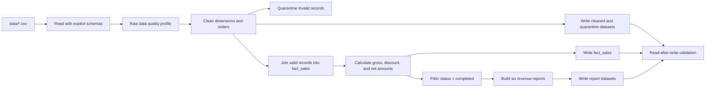

# Online Store ETL — PySpark

A small, end-to-end batch ETL project built with PySpark. It reads four CSV files for an online store, profiles the raw data, applies explicit cleaning and quarantine rules, builds a line-level sales fact, calculates revenue reports for completed orders, writes Parquet datasets, and validates the persisted outputs.

This README is intended to be a practical handoff: it describes the current implementation, how to run it, what results to expect from the supplied sample data, and what to revisit before extending the project.

> **Current scope:** local batch processing for the supplied CSV fixtures. There is no Airflow DAG, cloud deployment, database sink, incremental processing, or automated test suite in the repository today.

## Contents

- [What the pipeline does](#what-the-pipeline-does)
- [Repository layout](#repository-layout)
- [Requirements and setup](#requirements-and-setup)
- [Run the project](#run-the-project)
- [Data contract](#data-contract)
- [Pipeline stages and business rules](#pipeline-stages-and-business-rules)
- [Outputs](#outputs)
- [Validation and expected sample results](#validation-and-expected-sample-results)
- [Logging and troubleshooting](#logging-and-troubleshooting)
- [Design notes and current limitations](#design-notes-and-current-limitations)
- [Suggested next steps](#suggested-next-steps)

## What the pipeline does



`src/main.py` is the orchestration entry point. The pipeline uses a local Spark session (`local[*]`), so Spark runs on the machine that launches the command and can use its available local cores.

## Repository layout

```text
pyspark_etl_homework/
├── data/                         # Input CSV fixtures
├── output/                       # Generated Parquet datasets (created/overwritten by a run)
├── reports/
│   └── data_quality_report.md    # Raw-input quality snapshot, regenerated by a run
└── src/
    ├── main.py                   # End-to-end orchestration and console logging
    ├── read_data.py              # Explicit schemas and CSV ingestion
    ├── data_quality.py           # Raw data profiling and Markdown report
    ├── cleaning.py               # Cleaning, deduplication, and quarantine rules
    ├── joins.py                  # Fact table construction and row-count guard
    ├── sales_report.py           # Amount calculations and business aggregations
    ├── write_outputs.py          # Parquet persistence
    ├── validate_outputs.py       # Business and persisted-output checks
    ├── partitioning_demo.py      # repartition/coalesce/explain learning exercise
    ├── generate_data.py          # Recreates the sample CSV fixtures
    └── spark_test.py             # Minimal Spark startup/version smoke check
```

## Requirements and setup

The source uses Python and PySpark. The environment used for the project runs was observed as Python 3.12.3, PySpark 4.2.1, and OpenJDK 21.0.12.1. These are an environment snapshot, not a dependency lock file; the repository currently has no `requirements.txt`, `pyproject.toml`, or other dependency manifest.

A working Java runtime is also required. The environment used for this project had OpenJDK 21.0.12.1; check that Java is on `PATH` before launching Spark. From the repository root, create an isolated environment and install PySpark:

```bash
python3 -m venv .venv
source .venv/bin/activate
python -m pip install --upgrade pip
python -m pip install pyspark==4.2.1
```

Check the installed Spark version and that a local session starts:

```bash
python -m src.spark_test
```

If you already use the virtual environment in the parent directory, the equivalent invocation used during development is:

```bash
../.venv/bin/python -m src.main
```

Run the commands from the project root so Python can import the `src` package. Input, report, and output paths are derived from the source-file location, so the CSV inputs do not depend on the shell's current directory.

## Run the project

Run the complete ETL pipeline:

```bash
python -m src.main
```

Run the partitioning exercise separately:

```bash
python -m src.partitioning_demo
```

The demo builds the daily completed-sales report, prints its initial partition count and physical plan, applies `repartition(4)`, then applies `coalesce(2)`, and prints the resulting counts and plans. It is a learning exercise over a tiny aggregate; its partition counts are not a production tuning recommendation.

To recreate the CSV fixtures:

```bash
python -m src.generate_data
```

**Caution:** this command overwrites all four files in `data/` with the built-in sample dataset. Back up or commit any input changes before running it.

A normal successful `src.main` run refreshes `reports/data_quality_report.md`, overwrites each dataset under `output/`, checks business rules, reads each output back, and logs success. A failed validation raises an exception and the process exits unsuccessfully.

## Data contract

The pipeline expects these CSV files with header rows. The reader uses explicitly declared schemas; it does not rely on `inferSchema`.

| File | Column | CSV schema type | Cleaned representation |
|---|---|---|---|
| `customers.csv` | `customer_id` | integer | integer |
|  | `full_name` | string | string |
|  | `city` | string | string (`NULL` becomes `Unknown`) |
|  | `signup_date` | string | date; malformed values become null |
|  | `segment` | string | string |
| `orders.csv` | `order_id` | integer | integer |
|  | `customer_id` | integer | integer |
|  | `order_date` | string | date; invalid/missing values are quarantined |
|  | `status` | string | string |
|  | `payment_method` | string | string |
| `order_items.csv` | `order_id` | integer | integer |
|  | `product_id` | integer | integer |
|  | `quantity` | integer | integer |
|  | `unit_price` | `DECIMAL(10,2)` | `DECIMAL(10,2)` |
|  | `discount_pct` | `DECIMAL(10,4)` | `DECIMAL(10,4)` |
| `products.csv` | `product_id` | integer | integer |
|  | `product_name` | string | string |
|  | `category` | string | string |

`header=True` is enabled and the literal text `NULL` is interpreted as a null value. The reader declares every schema field as nullable; the cleaning rules decide which nulls are replaced, retained, or quarantined. Date columns are initially read as strings on purpose: malformed source values remain available for the raw quality report, then are parsed during cleaning with the `yyyy-MM-dd` format.

The expected relationships are:

- `orders.customer_id` → `customers.customer_id`
- `order_items.order_id` → `orders.order_id`
- `order_items.product_id` → `products.product_id`

The reader currently points to the four local files under `data/`. There is no external configuration layer for choosing another source path or environment.

## Pipeline stages and business rules

### 1. Ingest and inspect raw data

`src/read_data.py` loads the four CSVs using explicit schemas. `src/main.py` prints each raw schema with `printSchema()` and starts the raw data-quality analysis before cleaning changes the evidence.

### 2. Profile raw data quality

`src/data_quality.py` logs and writes a Markdown snapshot containing:

- Row and per-column null counts.
- Duplicate values for the configured customer, order, and product keys.
- Malformed non-null dates.
- Order-item quantity, price, and discount violations.
- Non-null foreign keys without a matching parent row.

The report is a **pre-cleaning snapshot**. Null foreign keys are visible in null counts and are not counted as orphan references. The report is regenerated on each run, so preserve or version it separately if historical run-by-run metrics are needed.

### 3. Clean dimensions and orders

`src/cleaning.py` applies these current rules:

| Dataset | Rule |
|---|---|
| Customers | Deduplicate by `customer_id`; replace a null `city` with `Unknown`; parse `signup_date`. An invalid non-null date becomes null, but the customer remains. |
| Products | Deduplicate by `product_id`. |
| Orders | Parse `order_date`; quarantine a missing order ID, missing customer ID, missing/invalid date, or customer ID that does not exist in cleaned customers; deduplicate valid orders by `order_id`. |

`cancelled` and `returned` order statuses remain in `cleaned_orders`. Status determines whether a sale contributes to revenue; it is not an order-cleaning rejection rule.

### 4. Clean order items and quarantine rejects

An order-item row is quarantined if it has a missing required value, quantity less than or equal to zero, negative unit price, discount outside `[0, 1]`, an unknown order, or an unknown product. Valid rows are written to `cleaned_order_items`; rejected rows are written to `quarantine_order_items` with a `reject_reason` column. Orders with an unknown customer are retained in `quarantine_orders`, also with a `reject_reason`.

The cleaning code assigns the **first matching reason** in its rule order. A row that violates multiple rules will therefore have one reason recorded, not a complete list of every violation.

### 5. Build the sales fact

`src/joins.py` joins valid order items to cleaned orders, customers, and products. The resulting `fact_sales` grain is one row per valid order line, with order, customer, product, quantity, price, discount, and status attributes. A row-count guard fails the run if the joins lose or multiply valid order-item rows.

### 6. Calculate amounts and build reports

`src/sales_report.py` calculates line-level amounts using decimal arithmetic:

```text
gross_amount    = quantity × unit_price
discount_amount = gross_amount × discount_pct
net_amount      = gross_amount − discount_amount
```

All six summary datasets are built from rows whose order status is exactly `completed`:

1. Total net revenue.
2. Daily net revenue.
3. Net revenue by product category.
4. Net revenue by customer city.
5. Count of distinct completed orders per day.
6. Top five customers by net revenue (customer ID breaks ties).

The detailed `fact_sales` dataset retains valid rows for other statuses, such as `cancelled`; those rows do not enter the six completed-sales reports. Thus the sum of every `fact_sales.net_amount` can differ from the completed-only revenue total.

### 7. Persist and validate

`src/write_outputs.py` writes local Parquet datasets in overwrite mode. `fact_sales` is partitioned by `order_month` (`yyyy-MM`); other outputs are written without an explicit partition column. `src/validate_outputs.py` checks business invariants and verifies that every expected output has a `_SUCCESS` marker and that the persisted row count matches the DataFrame row count.

## Outputs

The current pipeline writes these 13 datasets under `output/`:

| Dataset | Contents | Sample rows |
|---|---|---:|
| `cleaned_customers` | Deduplicated customers, normalized city, parsed signup date | 6 |
| `cleaned_products` | Deduplicated products | 5 |
| `cleaned_orders` | Valid, deduplicated orders, including non-completed statuses | 7 |
| `cleaned_order_items` | Valid order lines | 4 |
| `quarantine_orders` | Rejected orders with a reason | 1 |
| `quarantine_order_items` | Rejected order lines with a reason | 5 |
| `fact_sales` | Joined valid order lines with calculated amounts | 4 |
| `total_revenue` | Completed-only total net revenue | 1 |
| `daily_revenue` | Completed-only revenue by day | 2 |
| `category_revenue` | Completed-only revenue by product category | 3 |
| `city_revenue` | Completed-only revenue by customer city | 2 |
| `completed_orders_per_day` | Distinct completed order count by day | 2 |
| `top_customers` | Up to five completed-sales customers | 2 |

These counts are for the supplied sample fixture, not fixed expectations for other input data. `output/fact_sales/` contains Hive-style month partitions such as `order_month=2024-06/`. All output paths are local filesystem paths relative to the repository.

## Validation and expected sample results

The business checks in `src/validate_outputs.py` currently cover:

- Unique `customer_id` values in cleaned customers.
- Positive quantity and non-negative unit price in sales facts.
- `discount_pct` in `[0, 1]`.
- Completed-only status in the report input.
- Customer and product references in the sales fact.
- Reconciliation between completed detail net amounts and total revenue.

Then every persisted dataset is re-read from Parquet and its row count is compared with the corresponding in-memory DataFrame. These checks do not currently compare every persisted value or full schema against an expected contract.

For the bundled sample data, expected business results include:

- Completed net revenue: **458,000**.
- Daily net revenue: **230,000** on 2024-06-01 and **228,000** on 2024-06-02.
- Category net revenue: Accessories **50,000**, Electronics **180,000**, Furniture **228,000**.
- City net revenue: Shiraz **228,000**, Tehran **230,000**.
- Completed orders per day: one on each of 2024-06-01 and 2024-06-02.
- Top customers: Alice **230,000**, Babak **228,000**.

The raw quality report for the same fixture should show 7 customers, 9 orders, 9 order items, and 6 products; one null customer city; duplicate keys for customer 106, order 5007, and product 205; two invalid customer signup dates; two non-positive quantities; one out-of-range discount; and the orphan references reflected in the report. The current quarantine output has one order rejected for `orphan_customer` and five rejected order-item rows (two invalid quantities, one invalid discount, one orphan order, one orphan product).

## Logging and troubleshooting

The entry point configures timestamped Python logging to the console. Spark's own log level is lowered to `ERROR` for the pipeline run. Exceptions are logged with a traceback and re-raised; the Spark session is stopped in a `finally` block. There is no dedicated `logs/` file, rotation policy, or run-specific log file. A future Airflow task can collect the task's standard output and error streams, but an Airflow DAG is not included yet.

Common local messages:

- `hostname ... resolves to a loopback address`: Spark found a usable network interface; this is commonly an environment warning for local execution. If Spark cannot bind or connect, set `SPARK_LOCAL_IP` to the machine's reachable local IP for that run.
- `Unable to load native-hadoop library`: Spark is using its built-in Java implementations; for this local CSV/Parquet exercise this warning has been non-fatal.
- Incubator vector module warning: emitted by the Java runtime/Spark combination; it has not prevented the sample pipeline from running.
- Missing input or permission errors: confirm the four CSV files exist under `data/` and the process can write to `output/` and `reports/`.
- Unexpectedly high counts after a join: inspect dimension-key uniqueness and the row-count guard in `src/joins.py`; duplicate keys in a dimension can multiply fact rows.

## Design notes and current limitations

These are useful context before extending the project:

- **Local-only paths and execution:** Spark uses `local[*]`; inputs, reports, outputs, and `_SUCCESS` checks target the local filesystem. A distributed Airflow worker or cloud cluster needs a shared/object-storage location and a storage-aware success check.
- **Overwrite is not a multi-output transaction:** each dataset is overwritten independently. A failure midway may leave a mix of outputs from different runs. There is no staging directory, atomic publish step, run ID, or rollback.
- **No incremental processing:** each run reads all CSVs and replaces all outputs.
- **Duplicate and null-key handling needs a business policy:** `dropDuplicates(key)` does not define which row wins if two records with the same key contain conflicting values. It is safe for the identical duplicate fixture, but production data should use an explicit ordering or reject ambiguous duplicates. Customer and product cleaning also do not currently quarantine null primary keys; the supplied fixture has no such rows, so add explicit required-key checks before using different data.
- **Quarantine reason precedence:** only the first applicable validation reason is saved. Multi-reason diagnostics would require a reason array or separate rule flags.
- **Repeated Spark actions:** profiling, counts, joins, validations, and writes can evaluate the same lazy lineage multiple times. This is acceptable for the tiny fixture; larger inputs may benefit from selective persistence, fewer actions, and metrics collected in fewer passes.
- **Output validation is basic:** `_SUCCESS` plus row count detects missing/incomplete writes and row loss, but not schema drift, wrong values, duplicate rows, or stale data from a previous run.
- **No automated test framework or CI:** `spark_test.py` checks that Spark starts; it is not a unit/integration test suite. Business assertions currently run within the pipeline itself.
- **No external configuration or secrets management:** paths, app name, local master, and output behavior are fixed in source; there are no credentials or external services in this exercise.
- **Raw report versus run logs:** the Markdown quality report describes raw inputs, while cleaned/quarantine counts are mainly available from pipeline logs and the Parquet datasets.
- **Partitioning demo is instructional:** its daily report contains very few rows. The exercise illustrates shuffle and partition-count behavior; it does not establish an optimal partition count for larger workloads.

## Suggested next steps

A practical order for the next development cycle:

1. Add a dependency manifest and document the supported Python, Java, and PySpark versions.
2. Add small deterministic tests for cleaning, quarantine reasons, amount calculations, report totals, and output validation.
3. Define deterministic duplicate resolution and document status handling with the data owner.
4. Add schema/value checks for persisted Parquet and include post-cleaning/quarantine counts in a run manifest or quality report.
5. Make input/output paths and Spark settings configurable, then add run-scoped staging and a safe publish strategy.
6. If orchestration is required, add an Airflow DAG that invokes the pipeline, captures logs, passes configuration, and points all workers at shared storage.
7. Revisit caching, partition sizing, and shuffle behavior only after representative data volume and workload measurements are available.

When resuming work, start with `src/main.py` to understand the stage order, then inspect the stage module responsible for the change. Preserve the completed-sales revenue rule and the distinction between the full valid fact and completed-only reports unless the business requirement changes.
